# katashiro-canvas-writing

A markdown canvas is a document the user reads beside the chat. Plain paragraphs and bullet lists
work, but the canvas has blocks that make a document scannable. This skill says **which block for
which job**, the few syntaxes that break, and how to edit without fighting the editor.

## Requirements

- The current chat is a **Katashiro** chat, so `katashiro.canvas_*` tools are available.
- For a page the user should *interact* with (sort, filter, simulate), use an `html` canvas instead,
  and the `katashiro-canvas-file` skill to upload it. For an interactive system diagram, use
  `katashiro-archify`. This skill is about `markdown` (and `slides`) canvases.

## 1. Pick the block by what the content is

| The content is… | Write it as | Not as |
|---|---|---|
| 2–4 parallel things to compare (options, axes, principles) | `::: cards` with one `###` per card | three paragraphs in a row |
| A rule, a warning, a caveat the reader must not miss | `> [!NOTE]` / `[!TIP]` / `[!IMPORTANT]` / `[!WARNING]` / `[!CAUTION]` (optional title after the marker) | bold text in a paragraph |
| A short good/bad example line | `> ✅ …` / `> ⚠️ …` / `> ℹ️ …` (emoji callout, no title row; only these three, and the emoji must be the first character — `❌` / `💡` stay a plain quote) | a quote with no colour |
| Fields, options, numbers with several attributes | a table (header row, `---:` for numbers) | nested bullets |
| Terms and their meanings, events and when they fire | definition list: `Term` then `: meaning` on the next line | `**Term**: meaning` paragraphs |
| An enum or a list of values | a bullet list, one value per line | `a · b · c · d` on one line |
| A source, a version, an aside | a footnote `[^1]` with `[^1]: …` at the end | parentheses in the sentence |
| The one phrase that carries the point | `==highlight==` (once or twice per document) | bold everywhere |
| Something that is *not* what it seems | `++underline++` sparingly | ALL CAPS |
| Architecture, flow, sequence | a ```` ```mermaid ```` fence (see §3) | an ASCII drawing |
| Code, JSON, commands | a fenced block with its language | inline code for multi-line text |

Cards:

```markdown
::: cards
### Thin Bridge stays thin
Events rest only on facts OAB owns.

### Agent-portable
Works for claude, codex, gemini, kiro.
:::
```

- Every `###` directly inside starts a card; text before the first `###` is a card of its own.
  A card may hold a list, a table, a callout or a code block.
- 2–4 cards read best; more wrap to the next row.
- A `###` inside a list or a quote does not start a card. To nest a cards block, the outer one uses
  `::::`.

Callout with a title:

```markdown
> [!CAUTION] Caveat, normative for consumers
> A "session" is a pooled agent subprocess. `session.ended` is not a conversation close.
```

## 2. Shape of a good document

1. A one-line **eyebrow** above the title for context: `**RFC · DRAFT** / org / repo / v1`.
2. `# Title`, then a two- or three-sentence lede with one `==highlight==` on the key phrase.
3. A diagram early if there is a system or a flow.
4. `##` sections, each starting with one sentence that says what the section answers.
5. Comparisons as cards, rules as callouts, specs as tables.
6. End with open questions (numbered, each with a **bold question** and one line of context) or next
   steps, then footnotes.

Keep paragraphs short (≤ 4 lines). Tables are full width with no vertical rules: keep a table to the
columns that matter, and put long prose in the last column.

## 3. Diagrams

Diagrams are drawn by Pele or Mermaid — the user's setting, the switch in the canvas tab's header,
or `canvas_view({engine})`. Colour the nodes with `classDef` / `class`. Both engines apply it today,
but Pele does not guarantee it: a style it drops vanishes without an error, so check with a
screenshot after writing.

````markdown

```mermaid
flowchart LR
  P["Platform"] <-->|messages| O["OAB<br/>thin bridge"]
  O <-->|ACP| A["Agent CLI"]
  O -.->|telemetry| E["session.started · turn.completed"]
  classDef platform fill:#16233a,stroke:#4a86e8,stroke-width:2px
  classDef core fill:#2b1a14,stroke:#e89a4d,stroke-width:3px
  classDef agent fill:#173326,stroke:#3fb97a,stroke-width:2px
  classDef events fill:#3a2a18,stroke:#e89a4d,stroke-dasharray:6 4
  class P platform
  class O core
  class A agent
  class E events
```

````

- Dark fills with a brighter stroke read well on the dark canvas; give the main node the thickest
  stroke. The canvas is dark on screen and turns light only when printed, but `classDef` fills stay
  as written — dark fills print dark.
- Keep labels short; put detail in the text, not in the boxes.
- If one engine fails, the other draws the diagram and a small note under it says why; fix the
  source anyway. Only when both fail does the error show in place of the diagram.

## 4. Syntax that breaks — do not use

This section is about `markdown` canvases; a `slides` canvas is stored as written.

The canvas has no plugin for these, so they never render, and the editor (Milkdown), which rewrites
the stored markdown every time it saves, mangles them further. Do not write them:

| Avoid | Because the editor turns it into | Write instead |
|---|---|---|
| `H~2~O` (subscript) | `~~2~~` strikethrough | `H₂O` (Unicode) |
| `$$ … $$` math blocks | plain text without backslashes (`\,` → `,`) | a code block, or an image |
| `*[HTML]: …` abbreviations | escaped text | a footnote or a definition list |
| `[[toc]]` | escaped text | nothing — headings are enough |
| raw HTML (`<div>`, `<br>`, `<span style>`) | shown as text (HTML is off) | the blocks above |

Things that look odd after a save but are fine: `> [!NOTE]` comes back as `> \[!NOTE]` (still a
callout), `-` bullets come back as `*`, tables get padded, blank lines appear around `:::` and
`###` inside cards. Do not "fix" these.

## 5. Writing and editing

- **New document**: `katashiro.canvas_open` with `kind: "markdown"` and a short title. The result
  shows a `normalizedDiff`: the stored text is the normalized one.
- **Small change** (a section, a list, a diagram): `katashiro.canvas_patch` with `find`/`replace`
  copied from the **stored** text — `canvas_read` first if you have not seen it since the last
  write or the user may have edited. Several edits go in one call.
- **Rewrite**: `canvas_open` with `id`, `baseVersion`, `title` (required on every call) and the
  full content.
- **Side by side with a source page**: `canvas_open` with `beside: "current"` while the user is on
  that page (Split View).
- After a write, a `katashiro.screenshot` of the canvas tab (switch to it first) is the only way to
  see layout problems: cards too narrow, a diagram too wide, a table with one huge column.
- To show the user what you mean in the canvas, use `katashiro-point-at` (`canvas_highlight`). Its
  `find` matches the **rendered** text, not the markdown: `important`, not `**important**`.

## 6. Converting an artifact or a web page into a canvas

Map each designed part to a block rather than copying HTML:

| In the original | In the canvas |
|---|---|
| eyebrow / kicker line | bold first line (§2) |
| hero lede | lede paragraph with `==highlight==` |
| boxes-and-arrows drawing | coloured mermaid (§3) |
| side-by-side panels | `::: cards` |
| coloured example / caveat boxes | emoji callouts / `> [!CAUTION]` etc. |
| spec tables | tables |
| "Q1, Q2…" lists | numbered list with bold questions |

Custom fonts, a narrow reading column and exact colours are the canvas's theme, not the document's:
do not try to reproduce them with HTML.

## 7. Slides

A `slides` canvas is the same markdown split by lines that are exactly `---`. Cards, callouts,
tables and diagrams work on slides too; keep each slide to one idea and one block.
